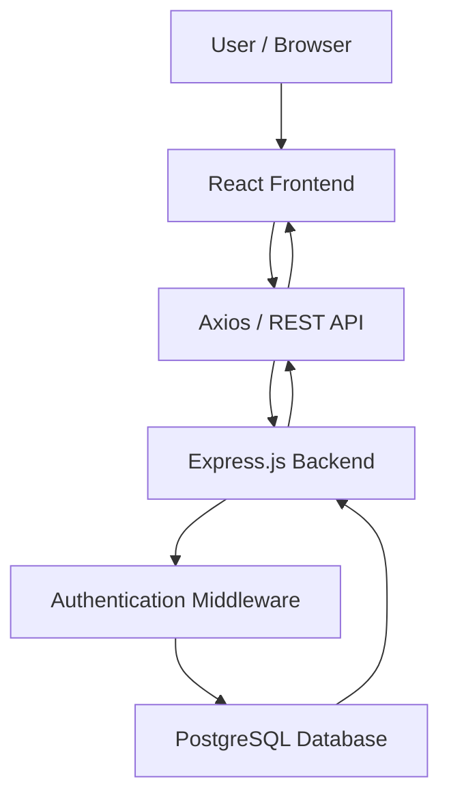

# ClinicCare HMS — Full-Stack Clinic Management System

A full-stack clinic management application designed to help small clinics and healthcare centers manage patient records, doctor information, appointments, and daily operations through a centralized dashboard.

**Live Demo:** [ClinicCare HMS](https://clinic-care-hms-client.vercel.app)  
**Repository:** [GitHub — ClinicCare-HMS](https://github.com/adarsh028-hash/ClinicCare-HMS)

---

## Table of Contents

- [Overview](#overview)
- [Features](#features)
- [Technology Stack](#technology-stack)
- [Application Architecture](#application-architecture)
- [Project Structure](#project-structure)
- [Getting Started](#getting-started)
- [Environment Configuration](#environment-configuration)
- [Database Setup](#database-setup)
- [Authentication and Security](#authentication-and-security)
- [Deployment](#deployment)
- [Future Improvements](#future-improvements)
- [Author](#author)

---

## Overview

ClinicCare HMS is a mini SaaS-style Hospital Management System built to simplify routine clinic operations and demonstrate full-stack web development concepts.

The application provides a centralized interface for managing doctors, patients, and appointments. Its React frontend communicates with a Node.js and Express backend through REST APIs, while PostgreSQL stores relational application data.

The project demonstrates practical implementation of frontend development, backend API design, database integration, authentication, authorization middleware, and cloud deployment.

## Features

### Authentication and Access Control
- Login using backend authentication.
- JWT-based authentication.
- Password hashing with bcrypt.
- Protected routes and authentication middleware.
- Role-based dashboard redirection.

### Doctor Management
- Create and manage doctor records.
- Store doctor contact and professional information.
- Maintain specializations, qualifications, and consultation fees.
- Generate doctor codes using the application's ID-based format.

### Patient Management
- Maintain patient information and contact details.
- Store patient registration information.
- Maintain blood group and emergency contact fields.
- Generate patient codes using the application's ID-based format.

### Appointment Management
- Schedule appointments between patients and doctors.
- Store appointment dates, times, and statuses.
- Retrieve appointment information through REST APIs.

### Dashboard and User Interface
- Centralized dashboard interface.
- Responsive layouts built with Tailwind CSS.
- Reusable React components.
- API integration using Axios.
- Client-side routing and protected pages.

> ClinicCare HMS is a portfolio and learning project. It is not intended to replace a production-ready clinical information system without further security, privacy, compliance, and reliability work.

## Technology Stack

| Layer | Technologies |
|---|---|
| Frontend | React.js, JavaScript, HTML5, CSS3 |
| Build Tool | Vite |
| Styling | Tailwind CSS |
| Routing | React Router |
| API Communication | Axios, REST APIs |
| Backend | Node.js, Express.js |
| Database | PostgreSQL |
| Database Hosting | Supabase |
| Authentication | JSON Web Tokens (JWT) |
| Password Security | bcrypt |
| Frontend Deployment | Vercel |
| Backend Deployment | Render |

## Application Architecture



### Request Flow

1. The user interacts with the React frontend.
2. The frontend sends HTTP requests to the backend through Axios.
3. Express routes process incoming requests and apply the required middleware.
4. Authentication middleware verifies JWTs on protected endpoints.
5. The backend reads or updates PostgreSQL records.
6. The backend returns a response to the frontend, which updates the interface.

## Project Structure

The repository is organized into separate frontend and backend applications.

```text
ClinicCare-HMS/
│
├── client/
│   ├── public/
│   ├── src/
│   │   ├── api/
│   │   ├── components/
│   │   ├── pages/
│   │   ├── App.jsx
│   │   └── main.jsx
│   ├── package.json
│   └── vite.config.js
│
├── server/
│   ├── config/
│   ├── controllers/
│   ├── middleware/
│   ├── routes/
│   ├── package.json
│   └── server.js
│
├── .gitignore
├── package.json
├── package-lock.json
└── README.md
```

*Note: The tree above illustrates the main application structure and representative files. Some paths may differ from the current repository; retain the actual filenames and folders present in your checkout.*

## Getting Started

Follow these instructions to run ClinicCare HMS locally.

### Prerequisites

Install the following tools before starting:

- [Node.js](https://nodejs.org/) and npm.
- [Git](https://git-scm.com/).
- A [Supabase](https://supabase.com/) project with the required PostgreSQL tables.
- A code editor such as [Visual Studio Code](https://code.visualstudio.com/).

### 1. Clone the Repository

```bash
git clone https://github.com/adarsh028-hash/ClinicCare-HMS.git
cd ClinicCare-HMS
```

### 2. Install Root Dependencies (If Required)

If the root `package.json` defines scripts or dependencies, install them from the root:

```bash
npm install
```

If the root package does not define dependencies, proceed directly to installing the client and server dependencies.

### 3. Configure and Start the Backend

Open a terminal:

```bash
cd server
npm install
```

Create a `.env` file inside the `server/` directory and configure the environment variables required by your backend.

Start the development server:

```bash
npm run dev
```

The local backend is expected to use port `5000` when `PORT` is not otherwise configured, based on the current server setup.

### 4. Configure and Start the Frontend

Open a second terminal from the project root:

```bash
cd client
npm install
```

Create `client/.env` if your frontend uses environment variables. Configure the API URL as described below.

Start the frontend:

```bash
npm run dev
```

Open the local URL printed by Vite in your terminal, commonly `http://localhost:5173`.

Keep both the backend and frontend running while testing the application.

## Environment Configuration

Environment variables keep configuration separate from application code.

### Backend

Create `server/.env` and configure the variables used by your database connection and server code.

For example, if your backend uses these variable names:

```env
PORT=5000
DATABASE_URL=your_supabase_postgresql_connection_string
JWT_SECRET=replace_with_a_long_random_secret
```

**Important:** Verify the exact database environment variable names in your backend database configuration before using this template. If the application uses separate PostgreSQL variables instead of `DATABASE_URL`, configure those names accordingly.

### Frontend

Create `client/.env`:

```env
VITE_API_URL=http://localhost:5000/api
```

This example assumes your Axios configuration reads `VITE_API_URL` and appends endpoint paths such as `/auth/login`.

For deployment, set the frontend API URL to your deployed backend API base URL, following the same convention used by your Axios configuration.

### Environment Variable Safety

- Never commit `.env` files containing secrets.
- Keep `client/.env` and `server/.env` in `.gitignore`.
- Never expose database passwords or JWT secrets in frontend environment variables.
- If a secret has already been pushed to a public repository, rotate it.

## Database Setup

ClinicCare HMS uses PostgreSQL hosted on Supabase.

The current database schema includes these core tables:

| Table | Purpose |
|---|---|
| `users` | User accounts, password hashes, and roles |
| `doctors` | Doctor profiles and professional details |
| `patients` | Patient records and contact information |
| `appointments` | Appointments linked to patients and doctors |

### Database Configuration

1. Create or open your Supabase project.
2. Ensure the required tables and relationships exist.
3. Configure the backend with the appropriate PostgreSQL connection settings.
4. Verify that the backend can connect to the database.
5. Use fictional records for local testing and demonstrations.

Doctor and patient identifiers are generated using the application's ID-based format:

- Doctor: `DD-YYYY-0001`
- Patient: `CC-YYYY-0001`

The year and padded numeric suffix depend on the current year and the corresponding database record ID.

## Authentication and Security

The application uses JWT-based authentication and bcrypt password hashing.

Security considerations for development and deployment:

- Store password hashes rather than plain-text passwords.
- Verify JWTs on protected backend endpoints.
- Enforce authorization on the backend, not only through frontend redirects.
- Keep JWT secrets and database credentials private.
- Validate and sanitize incoming API data.
- Configure CORS to allow only the intended frontend origins.
- Avoid publishing real patient information in demonstration datasets.

Frontend route protection improves navigation and user experience, but it must not be treated as a substitute for backend authorization.

## Deployment

The application uses the following deployment services:

| Component | Platform | Link |
|---|---|---|
| Frontend | Vercel | [Open Live Application](https://clinic-care-hms-client.vercel.app) |
| Backend | Render | [Backend Service](https://cliniccare-hms-server.onrender.com) |
| Database | Supabase | [Supabase](https://supabase.com/) |

Deployment checklist:

1. Configure the backend's production environment variables.
2. Connect the backend to the Supabase PostgreSQL database.
3. Configure CORS for the deployed frontend domain.
4. Set the frontend API URL to the deployed backend endpoint.
5. Verify authentication, doctor management, patient management, and appointment workflows.
6. Test page refreshes and protected routes on the deployed frontend.

## Future Improvements

Potential enhancements for future iterations include:

- [ ] Billing and invoice management.
- [ ] Appointment reminders and notifications.
- [ ] Medical history management.
- [ ] Advanced search, filtering, and pagination.
- [ ] Improved dashboard analytics and reporting.
- [ ] Doctor availability and schedule management improvements.
- [ ] Automated testing and API documentation.
- [ ] Enhanced audit logging and production security controls.

## Author

**Adarsh Biradar**

- GitHub: [@adarsh028-hash](https://github.com/adarsh028-hash)
- LinkedIn: [Adarsh Biradar](https://linkedin.com/in/adarsh-biradar-38a428338)

---

*Built as a full-stack development project to demonstrate practical skills in React, Node.js, Express, PostgreSQL, REST API integration, authentication, and deployment.*
